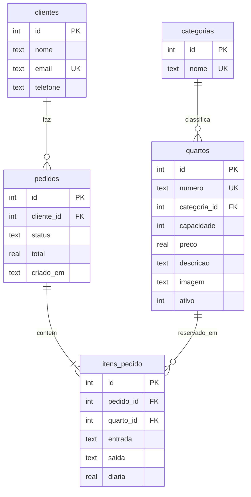

# Hotel Meridian – e-commerce de hospedagem

Tema: **E-commerce** (produtos = quartos, carrinho, pedidos = reservas, clientes e status de compra), aplicado a um hotel.
Pagamento real não está incluído. Todos os dados são fictícios.

## Objetivo
Permitir que o hóspede encontre quartos livres por período, monte um carrinho, finalize a reserva e acompanhe o status. A administração gerencia quartos, clientes e reservas.

## Funcionalidades
- Catálogo com **busca**, **filtro** (categoria, capacidade, disponibilidade por datas) e **ordenação** (preço, capacidade).
- Carrinho (salvo no navegador), checkout com validação e código da reserva.
- **Bloqueio de conflitos:** um quarto não pode ser reservado duas vezes no mesmo período (verificado no servidor, dentro de uma transação).
- Acompanhamento da reserva por código + e-mail.
- Painel administrativo (senha): **CRUD** de quartos e clientes, edição de status e exclusão de reservas, com busca e filtro por status.
- Interface responsiva (computador e celular), com modo escuro automático.

## Tecnologias e justificativas
| Item | Escolha | Motivo |
|---|---|---|
| Front-end | HTML, CSS e JavaScript puro | Sem build; fácil de explicar e depurar |
| Back-end | Node.js + Express | API REST simples e amplamente documentada |
| Banco | SQLite (`better-sqlite3`) | Relacional, com chaves e restrições; não exige instalar servidor (arquivo `hotel.db` criado sozinho) |

> Confirme com o(a) docente a aprovação do tema, do escopo e das tecnologias antes de apresentar.

## Pré-requisitos
- Node.js 18 ou superior (`node -v`)
- Internet apenas para instalar dependências, fontes e fotos de exemplo

## Instalação e execução local
```bash
npm install
npm start
```
Abra **http://localhost:3000**. Na primeira execução o banco é criado e populado com dados de demonstração.
Para reiniciar os dados, pare o servidor, apague `hotel.db` e execute `npm start` novamente.

Variáveis opcionais: `PORT` (padrão 3000) e `ADMIN_PASS` (padrão `admin123`).

## Credenciais de demonstração
- Administração (`#/admin`): senha **admin123**
- Acompanhar reserva: código **1** com e-mail **ana@exemplo.com** (também `bruno@exemplo.com` código 2, `carla@exemplo.com` código 3, `diego@exemplo.com` código 4)

## Modelo do banco de dados

- `quartos.numero` e `clientes.email` são únicos; `capacidade` e `preco` têm `CHECK > 0`.
- `pedidos.status` aceita apenas: Pendente, Confirmado, Hospedado, Concluído, Cancelado.
- `itens_pedido` tem `CHECK (saida > entrada)`; excluir um pedido remove seus itens (`ON DELETE CASCADE`).
- Quarto ou cliente com reservas **não pode ser excluído** (chave estrangeira), e o sistema mostra uma mensagem clara.
- `diaria` guarda o preço no momento da compra (o histórico não muda se o preço do quarto mudar).

## Validação e segurança básica
- Validação no navegador (campos obrigatórios, e-mail, números) e no servidor (campos, e-mail, datas, capacidade, preço, conflito de datas).
- Consultas SQL parametrizadas (sem concatenar entradas do usuário) e saída HTML escapada.
- Erros internos retornam mensagem genérica; detalhes técnicos ficam apenas no console do servidor.
- Rotas administrativas exigem token obtido no login.

## API resumida
`GET /api/quartos`, `GET /api/categorias`, `POST /api/pedidos`, `GET /api/acompanhar` (públicas) · `POST /api/login` · `/api/quartos`, `/api/clientes`, `/api/pedidos` (POST/PUT/DELETE/GET, administrativas).

## Estrutura
```
server.js        API, banco e dados de demonstração
public/index.html, css/style.css, js/app.js
```

## Uso de IA
Ferramenta: **Claude (Anthropic)**. Atividades: planejamento e geração do código inicial. *(Edite: descreva o que a equipe revisou, testou e alterou. Se não usou IA, escreva “IA não utilizada”.)*

## Limitações conhecidas
- Autenticação administrativa simples (uma senha, token em memória; reiniciar o servidor exige novo login).
- Sem pagamento real, sem e-mail de confirmação e sem contas de hóspede.
- Fotos de exemplo vêm de um serviço externo; sem internet o cartão exibe apenas um degradê.

## Contribuições da equipe
*(Preencha: nome de cada integrante e suas tarefas.)*
